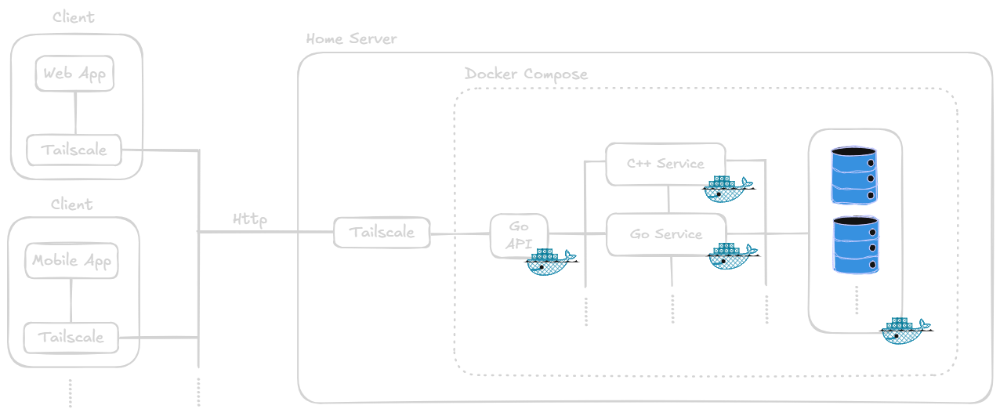

# homeserver

Custom multi-purpose home server.

## Architecture

For now the planned architecture is the follow:

All the backend service will be written in `Go` or `C++`. I choose these languages because are the one that i want to learn more. The drawing is already self explanatory but there will be a main **HTTP endpoint** that will communicate with the internal services via **TCP/UDP/HTTP** depending on the application. The internal service will communicate then with a Database interface that will handle the persistency of the server.

All the application are dockerized and they will work together via `docker compose`.

As shown in the image, the communication with exteranl client will be made using `tailscale`. I planned to implement both the web interface and mobile application in order to communicate with the server.

## Disclaimer

This project is meant to be for recreational purpouse only. All the decision made are part of my experience and personal developing. They could be wrong or not efficient but this is the goal of this type of projects.